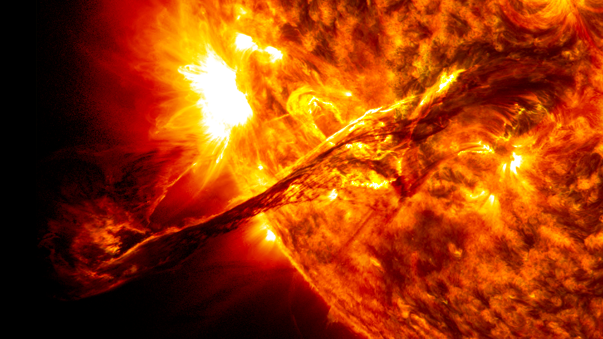
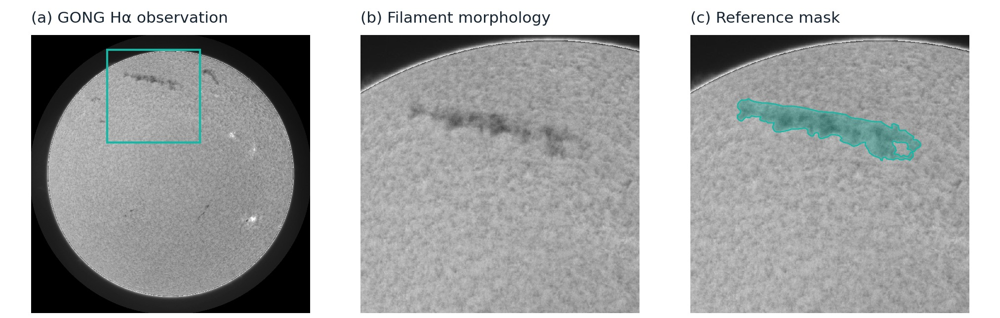
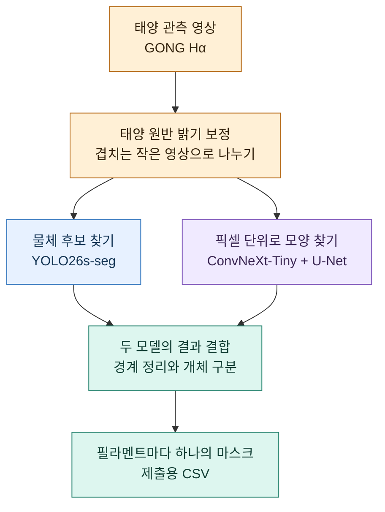
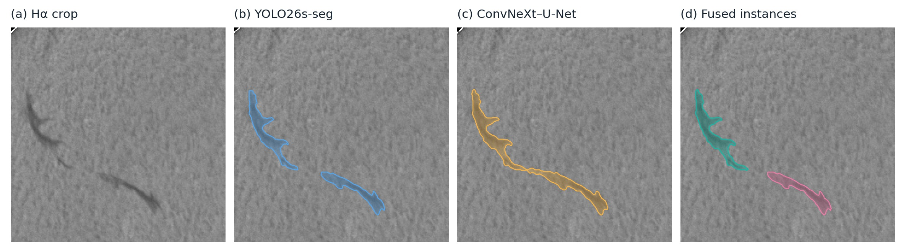
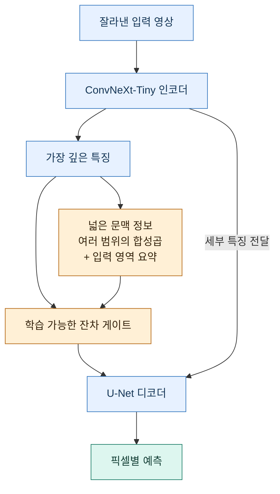
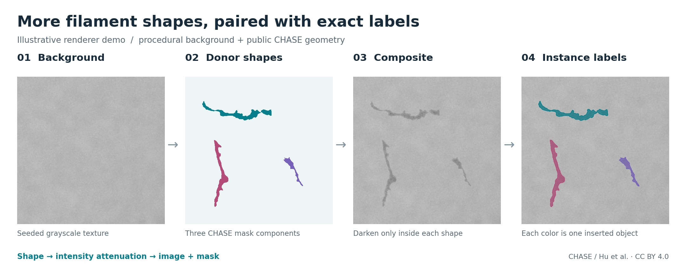

# Solar Filament Segmentation 2026

**태양 영상 속 검은 리본을 찾아, 하나씩 구분하고 모양을 그리는 AI.**

[English](README.md) · 한국어 · [Kaggle 대회](https://www.kaggle.com/competitions/filament-segmentation-2026) · [코드 실행하기](docs/TECHNICAL_GUIDE.ko.md)

*극자외선으로 관측한 태양 필라멘트의 분출 모습. 출처: [NASA/Goddard Space Flight Center](https://svs.gsfc.nasa.gov/11095/). 대회에서는 태양을 다른 파장으로 촬영한 흑백 Hα 관측 영상을 사용합니다.*

## 무엇을 찾는 프로젝트인가요?

**태양 필라멘트**는 자기장의 힘으로 태양 대기에 떠 있는, 길고 비교적 차가우며 밀도 높은 플라즈마 구조입니다. 태양 대기의 수소를 관찰하는 **Hα** 파장으로 보면 밝은 태양 원반 위에 검은 리본처럼 나타납니다. 그 모양을 찾아 기록하는 일은 시간에 따라 변하는 태양 구조를 연구하는 데 도움이 됩니다. [NSO의 필라멘트 설명](https://nso.edu/for-public/sun-science/prominence-filaments/)

[2026 태양 필라멘트 분할 대회](https://www.kaggle.com/competitions/filament-segmentation-2026)의 목표는 관측 영상에서 **필라멘트를 하나씩 찾아 각각의 영역을 표시하는 것**입니다. 이 프로젝트는 그 과정을 자동화합니다.

*왼쪽부터: 태양에서 위치 찾기 → 가까이 보기 → 모양 그리기. 청록색 영역은 공개 SWEFil 데이터에 사람이 표시한 정답입니다.*

| 입력 | 출력 | 어려운 점 |
|---|---|---|
| 2048 × 2048 크기의 GONG Hα 관측 영상 | 필라멘트마다 따로 구분한 픽셀 마스크 | 희미한 가지, 고르지 않은 밝기, 주변의 다른 어두운 구조 |

**마스크는 물체에 속하는 픽셀을 표시한 지도입니다.** 서로 다른 색은 각각의 필라멘트를 구분하기 위한 표시입니다. 희미한 부분까지 모양을 따라가면서도, 가까이 있는 두 필라멘트가 하나로 합쳐지지 않도록 해야 합니다. **Panoptic Quality(PQ)** 지표는 모양의 정확도와 개체 구분을 함께 평가합니다.

## 필라멘트를 찾는 파이프라인

두 모델이 같은 영상을 나란히 살펴봅니다. **YOLO26s-seg**는 필라멘트 후보와 그 영역을 찾고, **ConvNeXt-Tiny + U-Net**은 각 픽셀이 필라멘트일 가능성을 계산합니다. 두 결과를 결합해 희미한 구조를 보완하고 경계를 다듬습니다.

태양은 가장자리로 갈수록 어두워 보이므로 먼저 이 밝기 차이를 보정합니다. 영상을 겹치는 작은 영역으로 나누어 작은 구조를 살피고, 여러 방향에서 얻은 예측을 원본 좌표로 되돌린 뒤 결합합니다.

*저장된 실제 예측 예시: 입력 → 두 모델의 후보 → 결합된 필라멘트. 최종 결과에서는 각 픽셀이 최대 하나의 필라멘트에만 속합니다.*

## 주변 문맥까지 함께 보기

희미한 검은 부분만 보는 것보다, 주변으로 이어지는 긴 구조를 함께 보면 필라멘트를 구분하기 쉬워집니다. **문맥 블록(context block)** 방법은 U-Net 안에서 이런 넓은 시야를 더합니다. 여러 범위의 주변 정보를 살피는 확장 합성곱과 현재 입력 영역 전체를 요약하는 풀링을 결합합니다. 학습 가능한 게이트가 문맥 정보의 반영 정도를 조절하고, 스킵 연결은 세밀한 위치 정보를 디코더에 전달합니다.

[모델 구조 자세히 보기 →](docs/MODEL_ARCHITECTURE.md)

## 새로운 학습 예시 만들기

모델이 더 다양한 모양을 학습하도록 **형태 기반 데이터 합성**도 시도합니다. CHASE 마스크에서 가져온 필라멘트 모양을 회전·반전하거나 크기를 바꿔 깨끗한 태양 배경에 배치합니다. GONG 학습 관측에서 측정한 어두움과 경계 특성을 이용해 배경의 질감을 살리며 필라멘트를 표현하고, 배치한 모양으로 정답 마스크도 함께 만듭니다.

*공개 CHASE 모양과 절차적으로 생성한 배경으로 합성 방식을 보여주는 렌더링 예시입니다. 마지막 패널의 색은 자동으로 생성한 정답을 나타냅니다. [이미지 출처와 재현 방법](docs/assets/readme/README.md)*

CHASE 형태 합성 실험에서는 이미지마다 서로 겹치지 않는 모양 세 개를 배치합니다. 실제 관측과 합성 예시를 섞어 학습하며, 검증·시험 영상은 합성 재료에서 제외합니다.

[합성 방법과 학습 설정 자세히 보기 →](docs/CHASE_SHAPE_T4_TRAINING.md)

## 프로젝트 더 살펴보기

| 알고 싶은 내용 | 문서 |
|---|---|
| 코드 실행 방법과 실험 결과 | [한국어 기술 가이드](docs/TECHNICAL_GUIDE.ko.md) |
| 전처리, 마스크 결합, 제출 파일 생성 | [현재 파이프라인](docs/CURRENT_PIPELINE.ko.md) |
| U-Net과 문맥 블록의 구조 | [모델 구조](docs/MODEL_ARCHITECTURE.md) |
| GONG·SWEFil·합성 예시를 함께 쓰는 학습 | [혼합 데이터 학습](docs/SWEFIL_RETRAINING_PLAN.md) |
| 그림 출처와 재현 방법 | [그림 안내](docs/assets/readme/README.md) |

### 참고 자료

- [U-Net](https://arxiv.org/abs/1505.04597) · [ConvNeXt](https://arxiv.org/abs/2201.03545) · [Panoptic Quality](https://arxiv.org/abs/1801.00868)
- 태양 관측: **GONG / NSO**. 도입부의 공개 관측 영상과 정답: **SWEFil, Antonio Reche and Consuelo Cid, CC BY 4.0**. 전체 출처는 [그림 안내](docs/assets/readme/README.md)에 정리했습니다.
