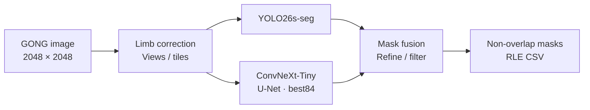
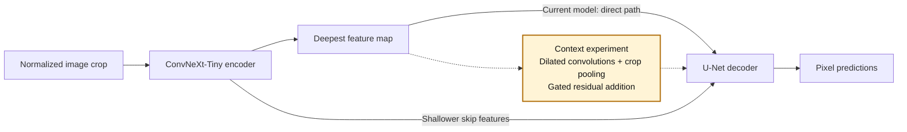

# Solar Filament Segmentation 2026

Finding and outlining dark, thread-like structures on the Sun with deep learning.

[Competition](https://www.kaggle.com/competitions/filament-segmentation-2026) · [Run in Colab](https://colab.research.google.com/github/ikjoo5/solar_filament/blob/main/notebooks/SolarFilament_GitHub_Colab.ipynb) · [Technical guide](docs/TECHNICAL_GUIDE.md) · [Korean documentation](README.ko.md)

## What are we looking for?

**Solar filaments** are clouds of relatively cool, dense plasma held above the Sun's surface by magnetic fields. Against the bright solar disk, they appear as dark threads or ribbons. These images come from **GONG**, a network of solar observatories, and show the Sun in **Hα**: a wavelength of light associated with hydrogen.

*The teal outline is a human annotation from the public SWEFil dataset. It illustrates the region a model should learn to identify.*

The [2026 Kaggle competition](https://www.kaggle.com/competitions/filament-segmentation-2026) asks us to find **each individual filament and outline its pixels** in 2048 × 2048 solar images. A pixel-by-pixel map of the selected region is called a **mask**. Faint structures, uneven brightness, and nearby dark features such as sunspots make the task difficult.

The score, **Panoptic Quality (PQ)**, rewards both finding the right objects and tracing their shapes accurately. Missing a filament, inventing one, or combining separate filaments can all lower the score.

## Model pipeline at a glance

Our submitted baseline combines **two independent models**. YOLO identifies individual filament candidates; a ConvNeXt-Tiny U-Net estimates which pixels belong to filaments. `best84` is the name of our selected U-Net checkpoint.

Both models look at image inputs. Their predictions meet at the mask-combination stage.

## From a solar image to separate filament masks

### 1. Make faint structures easier to see

The Sun's disk naturally looks darker toward its edge. **Limb-darkening correction** balances this center-to-edge brightness. The models also receive normalized pixel values so the input matches their training setup.

The YOLO branch also examines several contrast and filtering variants, including **CLAHE**, which adjusts contrast within small image regions. The figure shows one such view. The U-Net branch uses its own limb-corrected, normalized input.

### 2. Look closely with two models

Large images are examined in **overlapping crops** to retain small details. Flipped views let the models look at the same structure in different orientations; their predictions are then mapped back to the original image.

- **YOLO26s-seg:** proposes separate objects and their masks.
- **ConvNeXt-Tiny + U-Net:** recognizes patterns and turns them into a pixel-by-pixel filament map. This provides additional candidates and evidence about boundaries.

*These are actual saved predictions from the YOLO + best84 validation pipeline. Blue shows YOLO candidates, gold shows U-Net candidates, and each final color marks a separate predicted filament. This example illustrates how the branches can disagree about boundaries; it is not a new evaluation run.*

### 3. Combine the evidence and clean up

Postprocessing turns the model outputs into the final set of objects:

- **Check agreement across views:** use repeated detections to assess candidate reliability.
- **Combine and refine:** add supported candidates and selectively adjust boundaries using U-Net evidence.
- **Remove duplicates and weak candidates:** reduce repeated detections and false alarms.
- **Resolve overlaps:** assign overlapping pixels so the submitted masks remain separate.

The masks are returned to the original image coordinates and encoded as **RLE**—a compact way to store mask pixels as text—for the submission CSV. The [pipeline guide](docs/CURRENT_PIPELINE.md) documents the exact recipe.

## Where the context block fits

A faint filament may be easier to recognize when the model considers its surroundings. Our **context-block experiment** adds that wider view inside U-Net, between its encoder and decoder:

The **encoder** extracts visual patterns; the **decoder** builds the pixel map. The optional block mixes nearby detail, wider surroundings, and a summary of the crop. A learned gate controls how much of this extra information is added.

**The solid path is the submitted baseline. The dashed path is the experimental context block.** The block is implemented but is not enabled in the submitted best84 pipeline or the current mixed-data training run. See the [architecture walkthrough](docs/MODEL_ARCHITECTURE.md) for its calculations and results.

## Current progress and getting started

The independently generated **YOLO + best84 baseline scored 0.39 on the public leaderboard**. Its selected development-validation PQ was **0.472593**; this repeatedly used validation set is a different measurement from the leaderboard.

Current training work explores a fresh U-Net with GONG images, labeled SWEFil observations, and CHASE-derived synthetic filament shapes. The [mixed-data T4 notebook](https://colab.research.google.com/github/ikjoo5/solar_filament/blob/main/notebooks/SolarFilament_SWEFil_Mixed_T4.ipynb) and [training guide](docs/SWEFIL_RETRAINING_PLAN.md) describe that experiment; its performance remains to be measured.

| To explore further | Start here |
|---|---|
| Run the submitted baseline | [Colab notebook](https://colab.research.google.com/github/ikjoo5/solar_filament/blob/main/notebooks/SolarFilament_GitHub_Colab.ipynb) |
| Install, evaluate, or create a submission | [Technical guide](docs/TECHNICAL_GUIDE.md) |
| Understand the models and context block | [Architecture walkthrough](docs/MODEL_ARCHITECTURE.md) |
| Follow experiment history and recorded scores | [Current pipeline](docs/CURRENT_PIPELINE.md) · [Results](docs/TECHNICAL_GUIDE.md#recorded-results) |

Code and small explanatory figures are included here. Full datasets, trained weights, and prediction exports are stored separately; the execution guides explain which files are needed.

## Images and acknowledgments

The introduction uses a GONG observation and human annotation from **SWEFil**, by Antonio Reche and Consuelo Cid ([CC BY 4.0](https://creativecommons.org/licenses/by/4.0/)). The prediction example uses a crop from this project's GONG/MAGFiLO validation data and its archived model outputs. Solar observations are credited to **GONG / NSO Integrated Synoptic Program**. [Image sources, processing details, and reproduction instructions](docs/assets/readme/README.md).

The visual introduction was inspired by [Agnuxo1's competition repository](https://github.com/Agnuxo1/solar-filament-segmentation-2026). The figures shown here were created for this project from the sources above.
