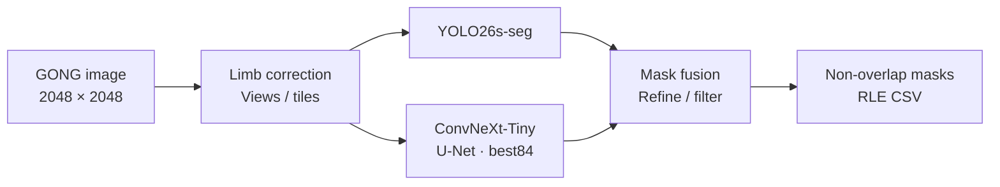
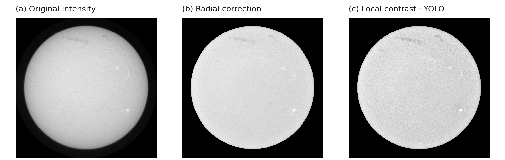
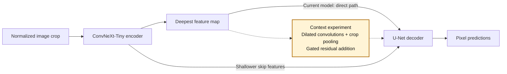

# Solar Filament Segmentation 2026

**Instance segmentation of solar filaments in full-disk Hα observations.**

A complementary detection and segmentation pipeline for the [2026 Solar Filament Segmentation Challenge](https://www.kaggle.com/competitions/filament-segmentation-2026).

## Scientific context

Solar filaments are relatively cool, dense plasma structures suspended in the solar atmosphere by magnetic fields. Observed against the solar disk in the hydrogen **Hα line at 656.28 nm**, they appear as dark, elongated features. Their irregular boundaries, fragmented appearance, and proximity to other dark structures make automated identification challenging.

This project identifies **individual filaments and their pixel boundaries** in 2048 × 2048 observations from the Global Oscillation Network Group (**GONG**). The objective is to preserve faint structure while distinguishing neighboring objects across the full solar disk.

## Model pipeline at a glance

The submitted baseline combines **YOLO26s-seg** with a **ConvNeXt-Tiny encoder and U-Net decoder**. YOLO proposes object masks; U-Net estimates filament probability at each pixel. The two networks process images independently, bringing complementary evidence to instance reconstruction. `best84` identifies the selected U-Net checkpoint.

The encoder extracts features at multiple spatial resolutions. The decoder combines these features through skip connections to recover fine spatial detail. Its foreground probability map supplies additional candidates and boundary evidence to the ensemble.

## Image formation and preprocessing

Solar **limb darkening** produces a systematic brightness decrease from the disk center toward its edge. Limb correction reduces this radial variation, followed by normalization appropriate to each model.

The YOLO branch evaluates additional contrast and filtering views, including **contrast-limited adaptive histogram equalization (CLAHE)**. Overlapping tiles retain small structures at full resolution, while geometric views sample different orientations. The U-Net branch uses limb-corrected 1024-pixel tiles with 25% overlap and four-orientation inference.

## Instance reconstruction

Predictions are mapped back to the original image coordinates. Agreement across views supports candidate selection; U-Net probabilities guide conditional additions and boundary refinement. Duplicate removal, candidate filtering, and overlap resolution produce a set of distinct filament instances.

Each output pixel belongs to at most one instance. Final masks retain the original 2048 × 2048 coordinate system and are stored as compressed COCO run-length encoding (**RLE**) in the submission CSV.

## Where the context block fits

The optional context block is **experimental and disabled in the submitted baseline**. It operates on the encoder's deepest feature map, combining parallel dilated convolutions with a pooled summary of the current crop. A learned residual gate controls the contribution of this wider context; shallower skip features preserve local detail.

## Evaluation

**Panoptic Quality (PQ)** measures both instance recognition and boundary agreement:

$$
\mathrm{PQ} = \frac{\sum_{(p,g)\in\mathrm{TP}} \operatorname{IoU}(p,g)}{|\mathrm{TP}| + \tfrac{1}{2}|\mathrm{FP}| + \tfrac{1}{2}|\mathrm{FN}|}
$$

Predicted and annotated masks match when their intersection over union (**IoU**) exceeds 0.5. Unmatched predictions and annotations contribute false positives and false negatives. Evaluation accumulates matched IoU and object counts across annotator–image groups.

| Submitted YOLO + best84 ensemble | PQ |
|---|---:|
| Selected development validation | **0.472593** |
| Public leaderboard | **0.39** |

Development validation was used repeatedly for model and parameter selection. The public leaderboard is a separate measurement on the competition test set.

## References

- Ronneberger, Fischer & Brox (2015). [U-Net: Convolutional Networks for Biomedical Image Segmentation](https://arxiv.org/abs/1505.04597).
- Liu et al. (2022). [A ConvNet for the 2020s](https://arxiv.org/abs/2201.03545).
- Kirillov et al. (2019). [Panoptic Segmentation](https://arxiv.org/abs/1801.00868).

[Architecture](docs/MODEL_ARCHITECTURE.md) · [Methods and recorded results](docs/CURRENT_PIPELINE.md) · [Technical reference](docs/TECHNICAL_GUIDE.md)

GONG / NSO solar observations. [Figure sources and credits](docs/assets/readme/README.md).
