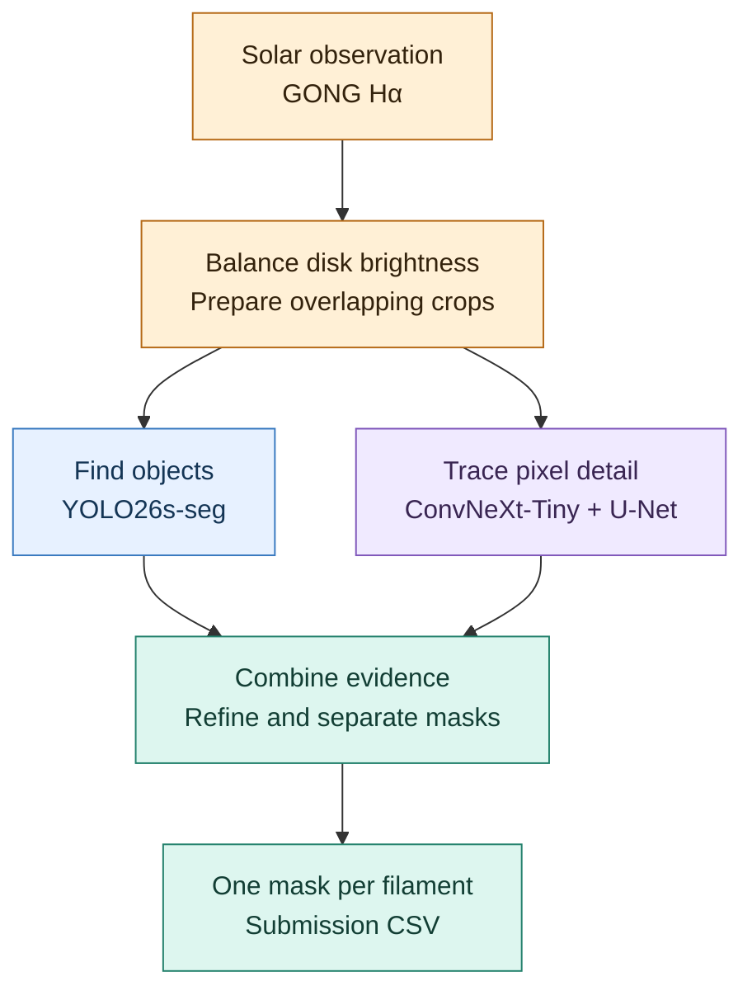
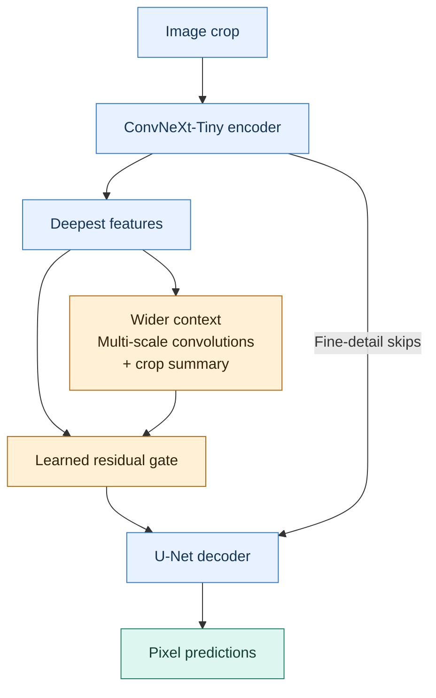

# Solar Filament Segmentation 2026

**Teaching a computer to find the Sun's dark ribbons — and trace each one separately.**

English · [한국어](README.ko.md) · [Kaggle challenge](https://www.kaggle.com/competitions/filament-segmentation-2026) · [Run the code](docs/TECHNICAL_GUIDE.md)

*A solar filament eruption, observed in extreme ultraviolet light. Credit: [NASA/Goddard Space Flight Center](https://svs.gsfc.nasa.gov/11095/). The competition uses a different view of the Sun: grayscale Hα telescope images.*

## What are we looking for?

**Solar filaments** are long strands of relatively cool, dense plasma held above the Sun by magnetic fields. Against the bright solar disk, they look like dark ribbons in **Hα**, a wavelength that reveals hydrogen in the solar atmosphere. Identifying their shapes helps researchers study these changing solar structures. [Learn more at NSO](https://nso.edu/for-public/sun-science/prominence-filaments/).

The [Solar Filament Segmentation Challenge 2026](https://www.kaggle.com/competitions/filament-segmentation-2026) asks a computer to turn a telescope image into **a separate outline for every filament**. This project builds that image-to-mask pipeline.

*Read left to right: find the structure on the Sun → look closer → trace its shape. The teal region is a human reference annotation from the public SWEFil dataset.*

| What goes in | What comes out | What makes it difficult |
|---|---|---|
| A 2048 × 2048 GONG Hα image | A pixel mask for each individual filament | Faint branches, uneven brightness, and nearby dark features |

**A mask marks which pixels belong to an object.** Different mask colors identify different filaments; the colors are labels, not the Sun's observed colors. A good prediction follows the full shape while keeping neighboring filaments separate. The challenge's **Panoptic Quality (PQ)** score measures both shape agreement and object recognition.

## How the pipeline finds each filament

Two models inspect the image in parallel. **YOLO26s-seg** finds candidate objects and their masks. A **ConvNeXt-Tiny + U-Net** model estimates how likely each pixel is to belong to a filament. Combining these views helps recover faint structure and refine object boundaries.

Brightness correction reduces the Sun's natural darkening toward the edge. Overlapping crops preserve small details, and predictions from several orientations are brought back to the original image coordinates before fusion.

*An actual archived prediction example: input → the two models' candidates → combined instances. Each output pixel belongs to at most one filament.*

## Using the surrounding context

A faint dark patch is easier to interpret when we can also see the longer structure around it. The **context-block method** adds this wider view inside the U-Net: parallel dilated convolutions examine several scales, and pooling summarizes the current crop. A learned gate controls how much this information changes the deepest features; skip connections carry fine detail to the decoder.

[Explore the model architecture →](docs/MODEL_ARCHITECTURE.md)

## Making more training examples

To give the model more shapes to learn from, we also explore **shape-based data synthesis**. Filament shapes from CHASE masks are rotated, reflected, and resized, then placed on a clean solar background. Darkening and edge characteristics measured from GONG training observations guide their appearance, preserving the background texture. The inserted shapes provide the matching instance masks automatically.

*A rendering illustration of the synthesis method, using public CHASE shapes and a procedural background. Colors in the last panel show the automatically generated labels. [Image sources and reproduction](docs/assets/readme/README.md).*

The CHASE-shape experiment creates three non-overlapping insertions per image. Real observations and synthetic examples are mixed during training; validation and test images are kept out of the synthesis ingredients.

[Synthesis method and training recipe →](docs/CHASE_SHAPE_T4_TRAINING.md)

## Explore the project

| I want to… | Start here |
|---|---|
| Run the code or see recorded results | [Technical guide](docs/TECHNICAL_GUIDE.md) |
| Follow preprocessing, mask fusion, and submission generation | [Pipeline walkthrough](docs/CURRENT_PIPELINE.md) |
| Understand U-Net and the context method | [Model architecture](docs/MODEL_ARCHITECTURE.md) |
| Explore training with GONG, SWEFil, and synthetic examples | [Mixed-data training](docs/SWEFIL_RETRAINING_PLAN.md) |
| Check image credits and reproduce the figures | [Figure sources](docs/assets/readme/README.md) |

### References

- [U-Net](https://arxiv.org/abs/1505.04597) · [ConvNeXt](https://arxiv.org/abs/2201.03545) · [Panoptic Quality](https://arxiv.org/abs/1801.00868)
- Solar observations: **GONG / NSO**. Public introductory image and annotation: **SWEFil, Antonio Reche and Consuelo Cid, CC BY 4.0**. Full credits are in the [figure guide](docs/assets/readme/README.md).
