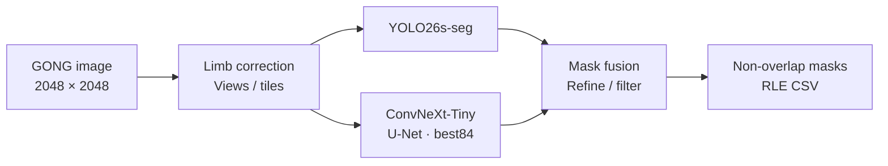
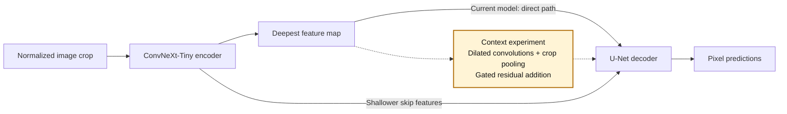

# Solar Filament Segmentation 2026

[Korean README](README.ko.md)

Research code for detecting and segmenting filaments in GONG Hα images and producing non-overlapping instance masks in the original 2048×2048 coordinates. The competition metric is PQ. Local evaluation follows the provided self-evaluation notebook: **strict IoU > 0.5 matching and accumulation across all annotation groups**.

## Model pipeline at a glance

The task is to find **each individual filament and its pixel mask** in a full-disk solar image. The current own-model submission baseline combines two models: **YOLO26s-seg** predicts instances, and **ConvNeXt-Tiny + U-Net (`best84`)** predicts a foreground probability map. Their predictions are combined to recover candidates, refine boundaries and remove duplicates.



YOLO and U-Net receive image inputs independently. The currently scored pipeline does not use YOLO boxes as the input to U-Net. The native network also has an auxiliary **spine output used during training**; final inference uses its foreground output only.

### Where the context block fits

The implemented context experiment inserts a block **after the encoder's deepest feature map, before the U-Net decoder**. It combines nearby patterns, wider surrounding structure and a summary of the current crop. This is intended to help the model interpret faint or fragmented filaments; it is a hypothesis to evaluate, not an assumed PQ gain.



**Solid path = current native model. Dashed path = the experimental replacement for the direct deepest-feature path.** The shallower skip features still reach the decoder unchanged.

| Configuration | Native network | Context block |
|---|---|---|
| Submitted own-model baseline, public LB **0.39** | Original `best84`, combined with YOLO | Off |
| Current GONG/SWEFil/CHASE training, **30/60/10** during mixed epochs | Fresh ConvNeXt-Tiny U-Net; native model only | Off |
| Historical context experiment | Original best84 warm start plus the residual context block | On; not adopted into the submitted baseline |

The block starts with a zero-valued gate: **`output = input + tanh(gate) × context(input)`**. Initially it passes the original features through unchanged; training can learn how much context to add. It uses regular convolution and pooling parameters, rather than LoRA's low-rank weight updates.

See the [architecture walkthrough](docs/MODEL_ARCHITECTURE.md) for the block's calculations, training behavior and experiment results. Implementation: [`MultiScaleResidualContext` and `PaperUNet`](tools/paper_multiscale.py). The new SWEFil Colab entry still follows its declared architecture; this documentation does not enable the block in that run.

## Recorded results

| Record | Value | Meaning |
|---|---:|---|
| Own-model baseline public LB | **0.39** | Displayed score confirmed by the user's actual submission |
| Fixed-validation PQ when selected | **0.472593** | Result on a repeatedly used development validation set |
| Original ensemble PQ in the CHASE comparison | **0.471930** | Control recomputed in that comparison run |
| Hybrid CSV with public predictions added/replaced: public LB | **0.45** | Separate from performance generated independently by the own model |
| External public CSV: public LB | **0.55** | Reference predictions, not test ground truth |

Start with the [current pipeline](docs/CURRENT_PIPELINE.md) for the architecture and latest experiment status. Other documents in `docs/` record their respective experiments at the time. Statements such as “not yet run” and historical score descriptions must be interpreted in that context rather than as the current status.

The current Colab entry point is the [notebook that loads source code from GitHub](notebooks/SolarFilament_GitHub_Colab.ipynb). It pins a repository version instead of requiring the entire codebase to be pasted as a compressed string, and reads data and weights from your Drive.

[Open in Colab](https://colab.research.google.com/github/ikjoo5/solar_filament/blob/main/notebooks/SolarFilament_GitHub_Colab.ipynb) · [Next CHASE/GONG experiment design](docs/CHASE_GONG_NEXT_EXPERIMENT.md)

For the **GONG + CHASE-shape training experiment**, use the separate [T4 training notebook](https://colab.research.google.com/github/ikjoo5/solar_filament/blob/main/notebooks/SolarFilament_CHASE_Shape_T4.ipynb) and [execution guide](docs/CHASE_SHAPE_T4_TRAINING.md). It starts a new ConvNeXt-Tiny U-Net from ImageNet initialization, follows the original best84 100-epoch recipe, and increases synthetic sampling to 50%. The completed run selected epoch 82: native-only development PQ **0.431339**, versus the logged same-runtime best84 **0.429419**. FP fell by 21 but FN rose by 6. The established full ensemble remains the submission baseline.

The [new epoch-82 test notebook](https://colab.research.google.com/github/ikjoo5/solar_filament/blob/main/notebooks/SolarFilament_CHASE_Test_T4.ipynb) applies that selected native-only recipe to all 180 test images. It runs inference only, resumes per image, and exports one checked submission CSV. The recovery entry refreshes Drive and locates the exact reviewed weight file if the training folder shows an older best-checkpoint pointer; it preserves that folder and the previous inference output. Its public leaderboard score has not yet been measured. See the [test submission guide](docs/CHASE_SHAPE_TEST_SUBMISSION.md).

If that project-folder search finds no checkpoint, the [Drive recovery notebook](https://colab.research.google.com/github/ikjoo5/solar_filament/blob/main/notebooks/SolarFilament_CHASE_Drive_Recovery.ipynb) also checks accessible active and trashed candidates through the Google Drive API. Only a verified copy is passed to inference; a missing match produces a report without launching training.

The new [SWEFil mixed T4 notebook](https://colab.research.google.com/github/ikjoo5/solar_filament/blob/main/notebooks/SolarFilament_SWEFil_Mixed_T4.ipynb) trains a fresh native model for 100 epochs with **all 250 labeled SWEFil observations**. During mixed epochs, the requested sampler is **GONG 30% / SWEFil 60% / CHASE-shape 10%**, with no temporal admission filter. The [execution guide](docs/SWEFIL_RETRAINING_PLAN.md) covers data, validation diagnostics and server-verified Drive checkpoints. Actual public data preparation and CPU checks passed; GPU training and PQ gains remain unmeasured.

## English documentation

- [Model architecture and context-block placement](docs/MODEL_ARCHITECTURE.md): encoder, decoder, skip features, auxiliary spine output and optional context computation.
- [Current pipeline and experiment branches](docs/CURRENT_PIPELINE.md): architecture, source map, external files, and current results.
- [GONG + all SWEFil + CHASE-shape T4 training](docs/SWEFIL_RETRAINING_PLAN.md): single-cell fresh training, automatic data download and verified checkpoint resume.
- [GONG + CHASE-shape T4 training](docs/CHASE_SHAPE_T4_TRAINING.md): implemented fresh-training recipe, clean-background synthesis, and automatic resume.
- [CHASE-shape epoch-82 test submission](docs/CHASE_SHAPE_TEST_SUBMISSION.md): frozen native inference recipe and resumable Colab export.
- [Independent CHASE evaluation](docs/CHASE_INDEPENDENT_RESULTS.md): completed model comparisons and postprocessing diagnostics.
- [Earlier CHASE/GONG experiment design](docs/CHASE_GONG_NEXT_EXPERIMENT.md): synthesis/adaptation alternatives and proposed controls; the current training guide supersedes its execution defaults.
- [Earlier CHASE-shape synthesis protocol](docs/CHASE_SHAPE_SYNTHESIS_PROTOCOL.md): background selection, local rendering, labels, and proposed matched controls, preserved as design history.
- [CHASE versus GONG](docs/CHASE_VS_GONG_20261104.md): observation, label, and dataset differences, with historical settings identified.
- [CHASE training design](docs/CHASE_BOTH_TRAINING.md): historical training instructions and configuration, not a report that every planned run was completed.

The original Korean README and `.ko.md` documents are retained. Dated experiment documents remain historical records in Korean; the English guides above provide the current entry points and distinguish completed work from proposals.

## Repository contents

- `tools/`: evaluation, model training, resume, independent inference, submission generation, and experiment code.
- `docs/`: designs, experiment records, and the limits of their interpretation.
- `tests/`: small synthetic cases for evaluation, coordinates, caching, and resume, plus reproduction checks that require separate assets.
- `requirements-*.txt`: dependencies for each task.
- `configs/`: shareable configuration examples. Set actual data paths in the execution environment.

Competition images, ground-truth files, split CSVs, synthetic images, checkpoints, prediction RLEs/CSVs, raw caches, and result ZIPs are stored separately. Cloning this repository does not provide historical trained weights or private inputs. Prepare the required files in your own Google Drive or local data directory.

## Installation and CPU evaluation

You can start in a separate Python 3.12 environment. Run the following commands from the repository root after cloning.

```bash
git clone https://github.com/ikjoo5/solar_filament.git
cd solar_filament
python -m venv .venv
source .venv/bin/activate
python -m pip install -r requirements-eval.txt
python -m unittest discover -s tests -p 'test_filament_eval.py' -v
```

To check only submission CSV formatting, RLE validity, and mask overlaps:

```bash
python tools/filament_eval.py --pred /path/to/submission.csv
```

To calculate PQ with ground truth from the same validation split:

```bash
python tools/filament_eval.py \
  --pred /path/to/validation_predictions.csv \
  --gt /path/to/validation_gt.csv
```

PQ is not calculated without ground truth. IoU against public test predictions measures reference agreement, not actual test recall or PQ. See `python tools/convert_annotations.py --help` for ground-truth JSON conversion. Do not combine predictions and ground truth from different splits.

## Generating a submission with the original baseline

A GPU environment with CUDA-compatible PyTorch and torchvision is required. In Colab, preserve the provided CUDA combination and install the additional packages needed.

```bash
python -m pip install -r requirements-submission.txt
```

The default submission engine uses native batch size 4, as used on A100. Save JSON such as the following, **replacing the paths with your actual locations**.

Editable examples are available for [A100](configs/submission.example.json) and [T4](configs/submission_t4.example.json). Private copies with filenames ending in `.local.json` are excluded from Git. The T4 Colab notebook uses a separate installation helper that preserves the existing CUDA libraries. The NumPy versions pinned in `requirements-eval.txt` and `requirements-submission.txt` differ, so keep CPU evaluation and GPU reproduction in separate environments.

```json
{
  "test_images": "/data/MAGFiLO_1.0_Kaggle_2026/test/test_images",
  "yolo_checkpoint": "/checkpoints/original_yolo/best.pt",
  "native_checkpoint": "/checkpoints/original_native/best.pt",
  "train_split": "/data/splits/train_split.csv",
  "val_split": "/data/splits/val_split.csv",
  "output": "/outputs/frozen_baseline_v1",
  "keep_stages": false
}
```

```bash
python tools/submission_driver.py \
  --config /path/to/submission.local.json \
  --result /path/to/submission_result.json
```

- Inputs are the original test images and the two checkpoints. The baseline does not read or mix in an existing submission CSV or the public 0.55 RLE predictions.
- SHA checks verify the original weights and splits. Do not compare a different model through this frozen reproduction path by simply disabling those checks.
- Completed per-image results and stage caches are saved. Rerunning with the same inputs, configuration, code, and runtime reuses completed work. Use a new output directory when conditions change.
- After all test images are complete, the engine writes `submission_pq0472593.csv`. The number in the filename refers to the historical validation baseline, not the generated file's LB score.
- The engine does not submit automatically to Kaggle.

`tools/r1_test_submission.py` is a separate engine for T4 batch size 1 that compares the full original pipeline and R1 using the same inference run. See `--help` and the [T4 settings in the current pipeline guide](docs/CURRENT_PIPELINE.md#producing-the-baseline-and-r1-together-on-t4). R1 produced **0.39 → 0.39** in the user-confirmed displayed public LB scores, so it is not recorded as an adopted improvement.

## Training and experiment entry points

| Purpose | Main source files | Required external assets |
|---|---|---|
| Native U-Net training/resume | `solar_a100_train_standalone.py`, `native_mixed_data.py` | GONG train/validation, annotations, selected synthetic data |
| Fixed-split synthetic experiments | `targeted_synthetic_data.py`, `targeted_synthetic_training.py` | Training-derived donors, backgrounds, and provenance metadata |
| 5-fold training/OOF evaluation | `fivefold_study.py`, `fivefold_full_pipeline.py`, `evaluate_fivefold_study.py` | New fold splits and the weights/caches for each fold |
| CHASE data/training | `chase_transfer_data.py`, `chase_best84_training.py`, `chase_yolo_training.py` | CHASE images/masks and the original GONG weights |
| Independent CHASE comparison | `chase_independent_plain_worker.py` | Completed CHASE experiment's Drive directory, manifest, and four checkpoints |
| Detection → ROI segmentation experiments | `roi_filament_pipeline.py`, `bbox_probe_pipeline.py`, `detr_best84_pipeline.py` | Experiment-specific detector/segmenter weights and configuration |

All source files listed above are under `tools/`. Consult each CLI's `--help` and its experiment documentation. Some historical launchers are intended to **reproduce an existing run** with pinned input hashes and provenance; they are not general-purpose training commands. Some Colab package builders require separate assets. Do not work around missing files by supplying empty data or arbitrary manifests.

Running every test indiscriminately may include checks that require external datasets, historical run directories, or GPUs. In a new environment, start with the data-free evaluation tests above, then run the tests and actual-input validation required for your task. Passing CPU checks is not evidence of completed GPU training or improved scores.

The following runs the core CPU checks without dataset files. These installation commands are for a **separate CPU environment**. Do not use them to replace GPU PyTorch in an active Colab CUDA environment.

```bash
python -m pip install torch==2.9.1 torchvision==0.24.1 \
  --index-url https://download.pytorch.org/whl/cpu
python -m pip install -r requirements-dev.txt
python tools/check_core.py
```

GitHub Actions is configured to run the same check list. This core suite does not include every historical reproduction test that needs datasets or previous results.

## Experiment principles

- Retraining comparisons use the original fixed split of 616 training images and 91 validation images. Validation contains 101 annotator groups and 708 objects.
- 5-fold OOF consists only of predictions from models that were not trained on the evaluated image. Do not insert `best84` or weights trained on a different fold into a new OOF evaluation.
- Synthetic donors, backgrounds, and image statistics come only from training data. Do not use validation/test data as material for synthetic training samples.
- Record SQ/RQ and TP/FP/FN alongside PQ. Distinguish improvements on repeatedly used validation/OOF data from actual LB improvements.
- CHASE remains a research direction. The CHASE-only 60-epoch weights do not replace the current baseline. The user's later request brings all labeled SWEFil observations into the new mixed training run; see the declared sampling and validation scope above.
- The completed CHASE-shape run used fresh ImageNet initialization and a 50% synthetic share. Its native-only results and limitations are recorded in the training guide. The earlier continuation/control pilot was a historical proposal, not the execution that produced those results.
- Later matched comparisons may train new models from the same generic pretrained weights. This is distinct from random initialization and from continuing the solar-specific `best84` checkpoint. Record the initialization source and keep it identical between compared branches.
