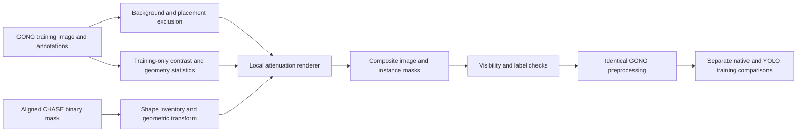

# CHASE shapes on GONG backgrounds: implementation and experiment protocol

Status: **historical proposal, superseded for the current run**. The user subsequently selected fresh ImageNet initialization, the original best84 100-epoch/400-crop schedule, a 50% synthetic probability, and copies of an external clean background. The implemented native-only entry is [GONG + CHASE-shape T4 training](CHASE_SHAPE_T4_TRAINING.md). Its recipe takes precedence over this document's proposed GONG-background insertion, full-pass budgets, paired controls, and auxiliary-validity scheme. Those remain possible separate experiments, not features of the current run. No new training result is claimed. SWEFFI is deferred.

## 1. Objective and first comparison

Test whether additional filament shapes improve instance detection on GONG without an uncontrolled increase in false positives. Use real GONG training images as backgrounds, CHASE masks as geometry, and GONG training statistics to determine the inserted intensity pattern. Do not import the full CHASE background or its entire automatic foreground/background supervision.

The first comparison measures the value of this synthesis package. A later control using GONG shapes through the same renderer is necessary before attributing a gain specifically to CHASE's shape diversity.



## 2. Data roles and backgrounds

| Source | Role | Restrictions |
|---|---|---|
| Original GONG train: 616 physical observations | Backgrounds, target appearance statistics, original labels, optional control donors | Keep all annotator variants with their source image; never draw from validation/test |
| GONG validation: 91 physical observations, 101 annotation groups, 708 objects | Model evaluation only | No generator calibration, donor mining, or background selection |
| CHASE AHAS: 695 observations | External positive-shape inventory | Automatic binary masks are geometry proposals, not expert instance IDs |
| Test images and public reference predictions | Final inference and separate reference-agreement diagnostics | Never generator material or synthetic target labels |

Use the original 2048×2048 GONG frame as the background. Preserve its solar texture, radial brightness, noise, sunspots, active regions, and already labeled filaments. Do not erase real filaments, globally inpaint the frame, or make all images from one `clean_solar.jpg` template. This retains target-domain diversity and the original context needed to control false positives.

Sample physical observations uniformly, then select an annotator group with the same deterministic policy in every experimental arm. Keep that group's original instance targets. The union of all training annotators' foreground masks is used **only for placement exclusion**, not merged into a new instance ground truth. Synthetic instances are appended to the selected group's labels. Other annotators' disagreements remain an existing dataset limitation; synthesis does not resolve them.

A location with no annotation is not guaranteed to be free of a filament. Use conservative local contrast/structure checks to veto an insertion location that contains an unexplained strong dark or bright feature. These checks do not classify or delete sunspots, do not create negative labels, and do not establish that the rest of the image is perfectly annotated. Inspect rejected and accepted locations during the preview audit.

## 3. Shape inventory and sampling

1. Reuse the verified CHASE file preparation and image/mask alignment. Preserve original files and explicit exclusion metadata. For the 2025 PNGs whose intensity grid differs from the published 2048×2048 mask, resize the entire intensity image to that mask grid using the verified author-compatible bilinear conversion; do not resize or crop the mask in this step. Then jointly align the image and mask to disk coordinates, using nearest-neighbor interpolation for masks.
2. Record each source mask's components, contours, holes, area, skeleton length, local width, curvature, branching, and radial position after alignment. Record measurement definitions and library versions.
3. A connected component is a **shape proposal**. Its source component index is not a true solar-filament instance ID. A rendered placement receives a new synthetic instance ID because we explicitly construct that object.
4. Do not discard branched/crossing shapes as inferred overlaps or merge disconnected components into an alleged physical object. Honor explicit overlap exclusions. Keep source masks intact and record technical renderability failures separately from overlap exclusions.
5. Sample source observations before sampling their shapes so images with many tiny fragments do not dominate. Use joint GONG training distributions of length, width, area, and radial position to organize shape sampling. Do not copy the historical generator's fixed 300–5,000-pixel gate.
6. Start with uniform scaling, rotation, and reflection. A provisional scale multiplier of 0.8–1.25 is applied after common disk-scale alignment; stratify and audit accepted shapes rather than assuming this range makes every CHASE shape GONG-like. Measure the final rasterized shape, not only the requested transform.

The initial renderer preserves relative width and branching. Do not expand every narrow CHASE fragment into a guessed complete GONG filament. If training-only measurements show a systematic width mismatch, evaluate a separately versioned width-adjustment variant that changes both the rendered signal and its label. This is a later ablation, not a hidden correction selected using validation masks.

Use the observed training distribution initially. Keep faint, thin, long, curved, and branched examples in the preview, but do not deliberately generate only the hardest extremes. Any later hard-example emphasis must use train-derived morphology/contrast bins or predictions genuinely out of fold within the training data; validation/test failures must not become donor-selection rules.

## 4. Placement

Initial engineering choices:

| Parameter | First setting | Purpose |
|---|---|---|
| Added objects per composite | 1 | Limit the object-density change and simplify error attribution |
| Exclusion margin around known foreground | 8 pixels at 2048 resolution, enlarged if required by rendering support | Protect existing labels and nearby context |
| Allowed added-object support | Entire support within normalized disk radius 0.94 | Avoid an initial limb-truncation experiment |
| Geometry | Estimate/validate each GONG disk | Do not silently assume every image has center (1024,1024) and radius 900 |
| Composite fraction per epoch | 308 of 616 observations | Match the control's GONG exposure count and optimizer budget |

The margin and disk rule apply only to new placements. Original near-limb filaments and original images are retained. Existing labeled pixels and all pixels outside the renderer support must remain unchanged in the raw composite. Added instances must not intersect the exclusion mask or one another.

Draw candidate radial locations according to the empirical training-object distribution within the permitted disk, not simply uniformly over image pixels. Stratify preview checks by disk radius, local brightness, and texture. The early interior-only setting does not claim to solve limb failures; extend to near-limb placements as a separate experiment after verifying the renderer.

For native training, choose the 1024×1024 crop from the original GONG data **before** rendering, using identical crop coordinates in control and synthesis arms. Place the added support fully inside that crop when feasible. This prevents nominally composite images from becoming ordinary crops with no synthetic object. The YOLO adapter reads the full frame. Record full-frame object placement and actual crop-visible coverage so per-model effective exposure is measurable.

Use bounded placement attempts. If an image cannot accept a valid placement, retain the original image, record the failed composite and its reason, and report the effective ratio; do not silently replace the image with an easier background or force a bad insertion to meet the target count. A systematic shortfall requires revising and refreezing the generator before training.

## 5. Rendering the intensity pattern

For a transformed binary shape M, construct a nonnegative, optical-depth-like field T supported by M. Starting from raw GONG intensity I in a consistent float representation, render:

```text
I_composite = (I + epsilon) * exp(-T) - epsilon
T = 0 outside M
```

This is an image-augmentation model, not a reconstruction of radiative transfer. It attenuates the target's own texture, avoiding a rectangular CHASE patch pasted onto a different background.

Construct T from a smooth interior-to-edge distance profile and weak spatially correlated modulation. Sample attenuation strength, edge-transition width, and modulation scale from GONG training examples with similar disk radius, brightness/noise, and shape scale. Estimate surrounding intensity from a local ring that excludes the union of known training foreground; fit a robust local background trend where necessary. Do not treat the dark object pixels as their own background reference.

Freeze the measured distributions before evaluating trained models. Sample appearance tuples from plausible joint ranges; independently sampling every marginal can create unnatural combinations such as a barely visible, extremely narrow object in heavy noise. Raw 8-bit histograms from CHASE and GONG are not sufficient to determine these settings.

Avoid uniform black fills, hard rectangular seams, central-only dark strokes labeled as broad objects, global histogram replacement, and generative whole-disk backgrounds in v1. No learned super-resolution is required. Any later reuse of CHASE's actual relative intensity pattern is a separate renderer variant.

Initial edge smoothing remains within the declared support. If a later blur spreads a visible signal outside it, explicitly account for that support in placement and label checks; do not blur the whole GONG image and call the original pixels unchanged. Audit the final 8-bit output, not only the float renderer.

Compose in raw space, then apply the same existing GONG preprocessing once in all arms. Do not stack a CHASE adaptation pipeline and another limb correction on top. The raw-pixel preservation assertion is made before this shared preprocessing: a preprocessing function that estimates global statistics may alter other pixels indirectly. Compare visibility again after preprocessing, resizing, and actual model-input crops.

## 6. Labels and supervision

- Store canonical synthetic instance masks as full-resolution binary RLE, with separate instance IDs, source IDs, and geometry/appearance provenance. Preserve original instance targets unchanged.
- Native foreground supervision uses the union of the selected annotator group's original instances and the added instance. Preserve genuine GONG spine supervision where it remains valid; ignore spine loss over the synthetic support and any affected halo. A CHASE skeleton is not automatically a genuine spine annotation. The adapter needs explicit per-head validity masks.
- Generate paired insertion recipes before training either arm. At each scheduled accepted insertion, apply the **same spine-validity exclusion to A's virtual support and B's actual support**, while leaving foreground supervision active in both. This prevents the comparison from changing auxiliary background supervision as well as the intended image/foreground targets. Preserve all remaining GONG spine supervision. For a later B/C donor-source comparison, freeze a common validity region covering both donor variants; if this changes B's training contract, run a newly matched B rather than silently comparing with the old checkpoint. This optional rerun is an additional budget, not included in the initial four runs.
- YOLO boxes and polygons come from the same canonical instances. Check rasterized polygon IoU, provisionally at least 0.95, and inspect the masks after the actual library's polygon resampling and training resize. Passing only the file-export check is insufficient.
- Record holes, fragmentation, and conversion failures. Do not alter the native canonical target just to accommodate YOLO. If no faithful YOLO representation is possible, preserve the source and report the unsupported sample; any paired-model comparison using different accepted sample sets must disclose that difference.
- Do not change losses, batch-normalization policy, preprocessing, or postprocessing between control and synthesis arms while testing the data intervention. If an auxiliary-loss policy must change, use it identically across both arms and record it as part of the new protocol.

## 7. Quality audit before training

Generate a deterministic preview of **96 composites** using training backgrounds only. Cross the following 12 strata, with 8 samples per stratum: 3 disk-radius bands × 2 target-contrast bands × 2 shape-width bands. Set band boundaries from training quantiles. Ensure the batch also includes long, curved, and branched geometry and different observation conditions; record overlaps between these descriptive categories rather than claiming independent groups.

For every preview item show the original crop, CHASE donor shape, composite crop, and complete target-mask overlay. Also retain a difference image and selected full-frame previews. Failures must remain inspectable alongside successes.

Audit:

- Existing labels and raw foreground pixels are preserved; inserted masks do not overlap protected support.
- No rectangular seams, black clipping, implausible edge halos, mask/image offset, or label on an invisible pasted object.
- Contrast, joint width/length/area, and edge-transition distributions are plausible relative to real GONG training objects.
- The declared shape remains visible after uint8 quantization, shared preprocessing, model resize, and native crop. A median change of 1 digital number alone is not a sufficient acceptance rule.
- Donor representation, annotator choice, source hashes, transformed-mask hashes, and placement rejection counts are traceable.

Calibrate numeric visibility bounds with real training examples, including faint ones, then freeze them. Do not choose bounds from validation PQ. The preview diagnoses synthesis artifacts, not the eventual model benefit. No positive PQ result is assumed from a visually convincing composite.

## 8. Full-pass training schedule and controls

One epoch contains **all 616 physical GONG training observations exactly once**. The control and synthesis arms use the same base-image order, annotation-group selection, crop coordinates, permitted geometric augmentation, and optimizer-update schedule.

In the synthesis arm, schedule 308 composites and 308 originals per epoch. For each two-epoch block, choose a deterministic set of 308 observations and use its complement in the second epoch. With successful rendering, each observation is presented 30 times as an original and 30 times as a composite over 60 epochs. The control sees the same observation 60 times without an insertion. Regenerate shapes/appearances through versioned per-epoch recipes rather than creating extra optimizer updates.

The 695 CHASE observations are a donor pool, not 695 additional full-frame training inputs per GONG epoch. Record donor-image and donor-shape coverage separately. Repeated crops/composites do not increase the number of independent background observations beyond 616.

| Stage | Arm | Initialization | Training intervention |
|---|---|---|---|
| Initial comparison | A: continuation control | Original GONG checkpoint, same for A/B | GONG images with the shared augmentation/crop recipe |
| Initial comparison | B: CHASE-shape synthesis | Same original GONG checkpoint | Replace the scheduled half of frames with one-object composites |
| If B improves | C: GONG-shape synthesis | Same initialization and budget | Use GONG donor shapes through the identical new renderer and placement/appearance budget |
| Later fresh-training comparison | A-fresh / B-fresh | Same generic pretrained weights, without competition fine-tuning | Matched GONG-only / GONG-plus-composite arms |

Arm C controls whether adding local foreground alone explains the gain. Match object counts and coarse size/contrast/location distributions, leaving donor shape diversity as the intended change. Do not use historical v2 images as C: their generator and sampling differ. Existing synthetic datasets are not newly added to one arm during this pilot; any previous influence already contained in the initial weights is shared.

Use a **60-epoch schedule per arm**, with diagnostics at epochs 15, 30, and 60. Intermediate inspection is not a claim that 15 or 30 epochs establishes convergence. For the continuation pilot, provisional common settings are AdamW, learning rate 2e-5, cosine decay over 60 epochs to 0.1 of the initial rate, weight decay 0.01, and AMP, retaining existing model-specific parameter grouping. These are starting settings, not a validated optimum. Initialize a new optimizer/scheduler identically for A/B; do not carry one arm's old optimizer state while resetting the other.

T4 uses sequential model runs: native 1024 crops, batch 1 with accumulation 4; YOLO 2048 full frames, batch 1 with its verified accumulation policy. No mosaic, MixUp, or new photometric augmentation is introduced in one arm only. When resuming the same arm, restore its optimizer, scheduler, scaler, RNG, epoch, and recipe identity. Never resume B from A's newly trained checkpoint.

Native A/B first, followed by reviewing results and then the corresponding YOLO A/B comparison, keeps both models in scope without starting all optional runs. Completing A/B for both models costs **4 runs × 60 epochs = 240 model-epochs**, not 60 total and not a five-fold run. Per arm there are 36,960 background-image presentations; native sees crops, not every pixel of every background. Runtime must be measured on the actual GPU. A fresh-training comparison is a later budget with its own convergence schedule, not an automatic extra run or a claim that 2e-5 suits fresh training.

## 9. Evaluation and decision rules

Keep the same fixed GONG validation split and strict IoU > 0.5 evaluator. Accumulate IoU sums and TP/FP/FN over all annotation groups before calculating PQ. Report the unmodified starting checkpoints as well as A and B.

1. Compare each model independently with identical decoding: PQ, SQ, RQ, TP, FP, FN, instance recall, and precision. Use training-defined size/contrast/radius bins for diagnostic breakdowns.
2. Report epoch 60 as the common endpoint. If also reporting a checkpoint selected by development PQ, apply the same selection rule and evaluation cadence to both arms and label it as selected on development data.
3. Inspect raw candidate coverage and final accepted masks separately. Increased GT-assisted candidate coverage is diagnostic, not achieved recall.
4. Evaluate original/new model combinations under a frozen ensemble recipe. Keep any later threshold or postprocessing retuning separate and give both arms the same tuning budget; do not attribute a new recipe's gain only to training.
5. Prefer reduced FN with stable or reduced FP and improved PQ. A large recall increase purchased with many extra predictions is not a successful result by itself. A model can also improve one metric at the expense of another, so retain the full tradeoff table.
6. Check whether gains are broadly distributed across physical observations. A paired bootstrap must resample each physical image with all its annotator groups together and recompute the aggregated metric. It does not remove bias from repeated development-set use.
7. If an improvement is small or inconsistent, repeat a matched seed before expanding the renderer grid. Generalization through a fresh fold-specific study and an actual leaderboard submission are later checks. Reusing best84 as initialization for folds it has already seen is invalid.

The public-reference 216/102 masks remain an auxiliary test-agreement diagnostic. Do not use them to tune the renderer, call them verified missed filaments, or treat their agreement score as PQ. The own-model public baseline remains 0.39 until an actual improved own-model submission establishes otherwise.

## 10. Storage, implementation boundaries, and deliverables

Keep original images, masks, and weights in their current Drive locations. Use a new experiment directory, for example `fixed_split_experiments/chase_shape_gong_v1/`, with separate `control/`, `chase_shape/`, and later `gong_shape/` outputs.

Persist the split/source manifest, frozen training-statistics artifact, donor inventory, per-epoch generation recipes, QA records, checkpoint states, and result summaries. Include background and donor hashes, observation/group/component IDs, original and transformed geometry, crop, attenuation parameters, seed, valid-pixel masks, library/code version, and rejection reasons. Fail resume on an incompatible identity rather than mixing caches.

Avoid writing tens of thousands of full-frame PNGs to Drive. Generate deterministic composites from compact recipes, use a bounded local image/cache buffer, and save only review examples plus compact reproducibility artifacts. Reconstruct the local cache after a Colab reset. Benchmark CPU generation before choosing worker counts; the initial T4 configuration should avoid caching all frames/masks in RAM.

Reusable pieces include CHASE integrity/alignment, GONG split checks, annotation rasterization, protected-pixel checks, atomic metadata storage, and polygon-export auditing. The current `targeted_synthetic_data.py` is pinned to old v2/v3 inputs, measured GONG residual donors, hardcoded placement geometry, and YOLO-oriented caches. The current native mixed loader also has its own sampling and polygon contracts. Neither becomes this experiment by changing a filename.

New work is required for the shape renderer, training-statistics calibration, canonical RLE-first storage, per-head validity masks, paired full-pass dataset adapters, and matched-run launcher. The next implementation deliverable is the generator plus the 96-case training-only preview and audit; model training follows after those checks pass. This document does not launch training or change deployed weights.
