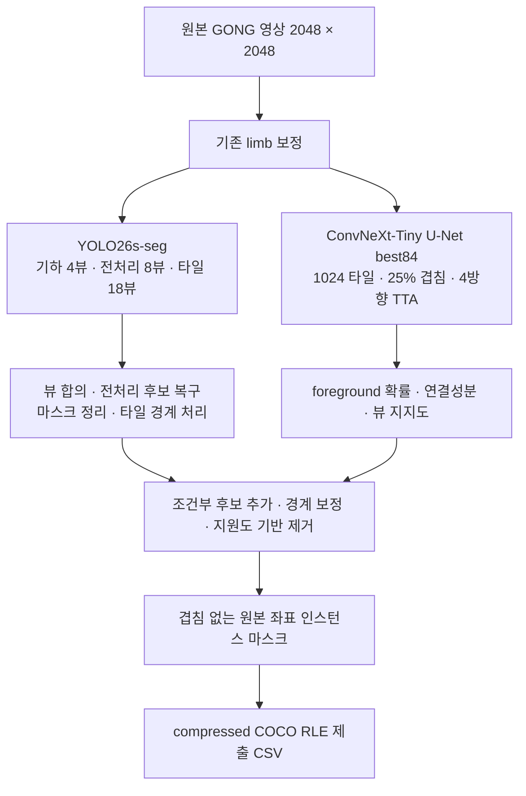

# 현재 파이프라인과 실험 분기

이 문서는 저장소의 현재 안내 문서다. 다른 실험 문서의 과거 진행형 표현보다 아래의 상태 구분을 우선한다. 날짜가 붙은 기록은 그 시점의 결과·계획을 보존한다.

## 자체 제출 기준선

- 기존 YOLO26s-seg와 native `best84`를 결합한 파이프라인이다.
- native는 **ConvNeXt-Tiny encoder + U-Net decoder**이며 foreground와 spine 두 채널을 출력한다. 고정 최종 조합 규칙은 foreground 지도를 사용한다.
- 검증 최고 PQ 0.472593은 반복 사용한 개발 validation의 수치다. 실제 자체 제출 public LB는 사용자가 확인한 **0.39**다.
- CHASE 비교에서 같은 원래 조합을 다시 실행한 대조군은 PQ 0.471930이었다. 과거 최고값과 같은 숫자라고 주장하지 않는다.
- R1 경계 복원을 더한 자체 제출도 표시 public LB **0.39**였다. 기존 기준선의 검증된 상승으로 채택하지 않는다.



YOLO와 native는 독립적으로 예측한다. 이 구조를 “YOLO가 bbox를 먼저 만든 뒤 U-Net이 그 ROI만 분할한다”고 설명하면 안 된다. detection→ROI U-Net, DETR→best84는 별도 실험 분기다.

## 실제 소스 연결

| 단계 | 코드 | 역할 |
|---|---|---|
| 전체 실행·입력 검증·재개 | `tools/submission_driver.py` | 가중치/분할 SHA, 입력 목록, 단계 캐시, 최종 CSV |
| 신경망 추론 | `tools/submission_inference.py` | limb, YOLO 뷰, native 타일·반전·확률 기록 |
| native 프로세스 분리 | `tools/submission_native_process.py` | 모델별 전역 환경 설정 간섭을 줄이는 지속 worker |
| YOLO 조합 | `tools/submission_yolo_recipe.py` | 기하 합의, 전처리 복구, smoothing, 타일 단계 |
| native 조합 | `tools/submission_native_recipe.py` | 조건부 추가, rich boundary 처리, 최종 admission/pruning |
| R1 비교 | `tools/r1_test_submission.py`, `tools/experimental_consensus_tails.py` | 같은 baseline에 지지된 경계 복원을 한 번 추가 |
| PQ·RLE 검사 | `tools/filament_eval.py` | 형식·겹침 검사, 정답이 있을 때 공식 방식 점수 |

제출의 열은 `filament_id,segmentation_rle`이며 식별자는 이미지 stem 뒤에 `_1`, `_2`처럼 객체 번호를 붙인다. 마스크는 원본 2048×2048 좌표다. 예측이 없는 이미지는 완료로 기록하지만 가짜 인스턴스 행을 만들지 않는다.

GT 없이 test PQ를 자체 계산하지 않는다. IoU>0.5는 매칭 조건이며, 매칭된 IoU 자체도 PQ의 분자에 반영된다. 전체 annotator-image의 IoU합·TP·FP·FN을 합산하고 PQ를 계산하며, 영상별 PQ나 fold별 PQ의 단순 평균으로 바꾸지 않는다.

## 외부에 보관해야 하는 파일

저장소에는 모델 가중치와 데이터 본문이 포함되지 않는다. 다음은 기존 실행의 대표 Drive 배치이며, CLI 설정 파일로 실제 경로를 지정한다.

```text
MyDrive/
  filament-segmentation-2026/
    MAGFiLO_1.0_Kaggle_2026/
      train/
        train_images/
        MAGFiLO_1.0_Annotations_kaggle2026_train.json
      test/test_images/
    synthetic_copy_paste_v2/
    external_CHASE/ahas_2024_2025/
    fixed_split_experiments/
    submissions/
  SolarFilament_LimbOnly_YOLO26_mixed_FullRes/
    best.pt
    train_split.csv
    val_split.csv
  SolarFilament_NativeUNet_A100/20261028T030808Z_bedf3e21/
    best.pt
```

원래 기준선의 SHA256:

| 파일 역할 | SHA256 |
|---|---|
| YOLO checkpoint | `81c2a27d95821b5ede283169c0da8c08d360ecc4c2a60a1b9c6baf96d76bcccc` |
| native best84 | `ae6b209f72355fd52d2cb07182e69028e97c703a1977ad1e7b38b27cf8cebe69` |
| train split | `aa0733424815731c5c108ada91e45525eb17ca3a42b377bf19e3089d86aede7e` |
| validation split | `54c6a9aac5a3b70b3ecc6721109a8b0fe8ec020e90cb56e3848fccc92eadc61f` |

해시가 다른 가중치로 실행하는 새 실험은 별도 프로토콜과 output을 사용한다. 과거 고정 파이프라인의 재현 검사만 삭제해 기존 점수와 동일하다고 간주하지 않는다.

## T4에서 기준선과 R1을 같이 만드는 경로

`tools/r1_test_submission.py`는 T4용 native batch 1과 독립 native 프로세스를 지원한다. 다음 예시를 실제 경로로 바꾼 JSON으로 저장한다.

```json
{
  "output_root": "/outputs/best84_r1_t4_v1",
  "images": "/data/MAGFiLO_1.0_Kaggle_2026/test/test_images",
  "expected_names_path": "/data/official_image_names.json",
  "yolo_checkpoint": "/checkpoints/original_yolo/best.pt",
  "native_checkpoint": "/checkpoints/original_native/best.pt",
  "device": "cuda:0",
  "native_batch": 1,
  "precision": "fp16",
  "expected_images": 180
}
```

```bash
python tools/r1_test_submission.py --config /path/to/r1.local.json --max-images 2
python tools/r1_test_submission.py --config /path/to/r1.local.json
```

처음 2장의 실행은 동작 확인이며 완성된 제출이 아니다. 180장 전체가 완료되면 같은 추론에서 다음을 저장한다.

- `submission_pipeline_baseline.csv`: R1 적용 전 자체 모델 예측.
- `submission_pipeline_R1.csv`: R1 적용 후 비교 대상.
- `change_audit.csv`, `run_manifest.json`, `results.zip`: 변경·실행 기록.

위의 `official_image_names.json`도 별도로 준비한다. 구현이 형식·SHA를 확인한다. 폴더 이름만 보고 180장이라고 간주하지 않는다.

## 학습과 검증의 분리

- 모델 구조·loss·학습률·학습 증강을 바꾸는 비교는 고정 train616 / validation91을 사용한다.
- 같은 물리적 영상의 다른 annotator 라벨을 train과 validation에 나누지 않는다.
- 전처리·후처리의 비교에는 5-fold OOF 코드를 사용할 수 있다. 각 영상은 그 영상을 학습하지 않은 fold 모델로 예측한다.
- 원래 고정 분할에서 학습한 best84나 solar YOLO는 새 5-fold의 범용 초기값으로 재사용하지 않는다.
- 5-fold 기준선의 설계는 각 fold에서 YOLO/native를 각각 30epoch 학습하고 공통 단계에서 비교하는 것이다. 로그의 schedule 상한100과 해당 실행의 종료 목표30을 구분한다. 완료 상태·가중치·예측이 모두 있어야 완성된 OOF라고 부른다.
- 참조 구현은 `fivefold_study.py`, `fivefold_full_pipeline.py`, `evaluate_fivefold_study.py`다. 과거 설계의 상세 내용은 `FIVEFOLD_STUDY_V2.ko.md`에 있다.

## CHASE 실험의 현재 위치

기존 GONG 학습 모델에서 CHASE AHAS695장만으로 YOLO/native를 각각 60epoch 추가 학습했다. 그 실험에서는 GONG replay를 하지 않았다. native의 평가용 새 가중치는 `native/last.pt`의 epoch60, YOLO는 `yolo/epoch060.pt`다. native의 `best.pt`는 GONG 검증상 epoch0을 보존하므로 새 모델 비교에 사용하는 파일과 구분한다.

이후 모델을 독립시켜 같은 91장에 원본 입력/limb 입력의 8조건을 실행했다. 단일 base view와 최소 decoder를 적용했으므로 위 복합 파이프라인 PQ와 같은 조건의 비교는 아니다.

검증 절차와 추가 임계값·팽창 진단은 [독립 검증 결과](CHASE_INDEPENDENT_RESULTS.ko.md)에 정리했다.

| 모델 | 원본 입력 PQ | limb 입력 PQ |
|---|---:|---:|
| 기존 YOLO | 0.399286 | 0.396637 |
| CHASE60 YOLO | 0.077358 | 0.091471 |
| 기존 native U-Net | 0.400068 | 0.406802 |
| CHASE60 native U-Net | 0.072098 | 0.066450 |

- limb를 제거하는 것만으로 큰 하락을 해소하지 못했다. confidence/foreground threshold의 제한된 비교에서도 기존 약0.40으로 회복하지 못했다.
- CHASE 모델에서는 GT의 일부를 작게 출력하는 마스크가 많았다. 위치가 GT 안에 있어도 IoU≤0.5이면 FP/FN이 된다.
- CHASE 자체가 쓸모없다는 결론은 아니다. 현재 CHASE-only 학습 방식과 라벨·관측 분포의 조합이 대상 GONG에서 효과적이지 않았다는 뜻이다.
- AHAS는 모델+DenseCRF+hole filling 뒤 사람이 선별한 자동 binary 라벨이며, GONG의 수동 instance 라벨과 같은 품질·객체 정의가 아니다.
- 다음 파일럿은 원래 GONG 가중치에서 GONG만 이어 학습한 대조군과 CHASE 형태를 GONG 배경·명암에 결합한 국소 합성을 먼저 비교한다. 기존 합성 기반 코드는 있지만 CHASE shape-only 렌더러는 아직 구현하지 않았다. GONG+실제 CHASE와 GONG+관측 특성을 맞춘 CHASE도 후속 대조군으로 유지한다. [선택 이유와 실험 설계](CHASE_GONG_NEXT_EXPERIMENT.ko.md)를 참고한다. 미구현·미학습 개선을 달성한 것으로 기록하지 않는다. SWEFFI는 마지막 단계로 보류한다.

실행 코드는 `chase_independent_plain_worker.py`다. 이는 기존 CHASE 실험 root의 고정 코드·manifest·영상·가중치를 검사하는 재현용 worker이며 새 clone만으로 완료할 수 있는 작업은 아니다.

```bash
python tools/chase_independent_plain_worker.py \
  --root /path/to/chase_only_both_alignment_t4_60ep_fullpass_pngfix_v1 \
  --role new_native
```

각 role은 raw/limb를 실행한다. role은 `old_yolo`, `new_yolo`, `old_native`, `new_native` 네 가지다. 원본 영상·모델·코드·runtime에 연결된 이미지별 캐시를 보관하며 가중치를 바꾸는 학습은 하지 않는다.

## 공개0.55 예측을 사용하는 별도 분기

- 공개 CSV의 public LB0.55는 사용자가 제출해 확인한 수치이며 개별 예측이 GT라는 뜻은 아니다.
- 자체0.39 CSV에 공개216 마스크를 추가한 혼합 제출이0.42, 독립적인102 마스크를 추가 교체한 혼합 제출이0.45였다.
- 이를 자체 모델의 학습 개선이나 숨겨진 test 라벨 복원에 성공한 결과로 기록하지 않는다.
- 216/102 참조의 후보 포함률은 검출 오류 원인을 조사하는 보조 지표다. 실제 PQ는 정답이 있는 validation/OOF에서 평가하고 LB는 제출 결과로 별도 관리한다.
- `track_reference216.py` 등의 참조 진단 코드를 사용할 때도 원래 공개 CSV·참조 목록은 외부 입력이다. 저장된 예측 데이터는 코드 공개 대상에 포함하지 않는다.

## 재현성의 범위

평가 함수·RLE·원본 좌표·빈 영상·픽셀 소유권·캐시 무결성·중단 재개는 작은 CPU 사례와 기존 예측의 재생으로 검사한다. 체크포인트·이미지·라이브러리/GPU 조건이 바뀌면 cache identity를 바꾸거나 고정 재현 조건과의 불일치로 중단한다.

GPU 학습 시간·메모리·최종 점수는 실제 환경에서 확인해야 한다. 저장소 공개 시의 테스트 결과는 공개 작업 보고에 기록하며, 과거 모든 실험을 새 clone만으로 재실행했다고 주장하지 않는다.
