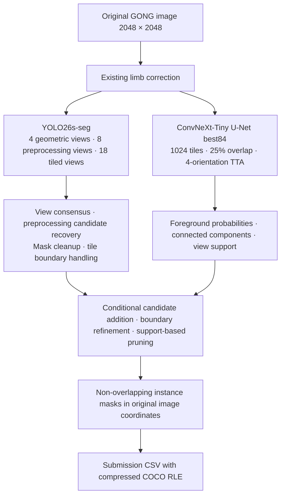

# Current pipeline and experiment branches

[Korean original](CURRENT_PIPELINE.ko.md)

This is the current guide to the repository. The status distinctions below take precedence over descriptions of work in progress in older experiment documents. Dated records preserve the results and plans from their respective periods.

## Own-model submission baseline

- The pipeline combines the original YOLO26s-seg model with the native `best84` model.
- The native model uses a **ConvNeXt-Tiny encoder + U-Net decoder** and outputs foreground and spine channels. The frozen final combination recipe uses the foreground map.
- The highest validation PQ of 0.472593 was obtained on a development validation set used repeatedly. The user-confirmed public LB score of the actual own-model submission is **0.39**.
- Rerunning the same original ensemble as a control in the CHASE comparison produced PQ 0.471930. This is a separate measurement from the historical best value.
- The own-model submission with R1 boundary restoration also had a displayed public LB score of **0.39**. R1 is not recorded as a verified improvement over the baseline.



YOLO and the native model make independent predictions. This architecture is not a sequence in which YOLO first generates bounding boxes and U-Net then segments only those ROIs. Detection → ROI U-Net and DETR → best84 are separate experiment branches.

## Source code map

| Stage | Code | Role |
|---|---|---|
| Execution, input validation, and resume | `tools/submission_driver.py` | Weight/split SHA checks, input lists, stage caches, final CSV |
| Neural network inference | `tools/submission_inference.py` | Limb correction, YOLO views, native tiles/flips/probability recording |
| Separate native process | `tools/submission_native_process.py` | Persistent worker that reduces interference between model-specific global environment settings |
| YOLO combination | `tools/submission_yolo_recipe.py` | Geometric consensus, preprocessing recovery, smoothing, tiled stages |
| Native combination | `tools/submission_native_recipe.py` | Conditional additions, rich boundary processing, final admission/pruning |
| R1 comparison | `tools/r1_test_submission.py`, `tools/experimental_consensus_tails.py` | Applies supported boundary restoration once to the same baseline |
| PQ and RLE checks | `tools/filament_eval.py` | Format/overlap validation and official-style scoring when ground truth is available |

The submission columns are `filament_id,segmentation_rle`. Identifiers append an object number such as `_1` or `_2` to the image stem. Masks use the original 2048×2048 coordinates. Images without predictions are recorded as complete without creating a dummy instance row.

Test PQ cannot be calculated without ground truth. IoU > 0.5 is the matching condition, and the matched IoU values also contribute to the PQ numerator. The evaluator accumulates the IoU sum, TP, FP, and FN across all annotator-image groups before calculating PQ; this must not be replaced with a simple average of image-level or fold-level PQ.

## Files kept outside the repository

Model weights and dataset contents are not included in the repository. The following is a representative Drive layout from existing runs. Set the actual paths through the CLI configuration file.

```text
MyDrive/
  filament-segmentation-2026/
    MAGFiLO_1.0_Kaggle_2026/
      train/
        train_images/
        MAGFiLO_1.0_Annotations_kaggle2026_train.json
      test/test_images/
    synthetic_copy_paste_v2/
    external_CHASE/ahas_2024_2025/
    fixed_split_experiments/
    submissions/
  SolarFilament_LimbOnly_YOLO26_mixed_FullRes/
    best.pt
    train_split.csv
    val_split.csv
  SolarFilament_NativeUNet_A100/20261028T030808Z_bedf3e21/
    best.pt
```

SHA256 values for the original baseline:

| File role | SHA256 |
|---|---|
| YOLO checkpoint | `81c2a27d95821b5ede283169c0da8c08d360ecc4c2a60a1b9c6baf96d76bcccc` |
| Native best84 | `ae6b209f72355fd52d2cb07182e69028e97c703a1977ad1e7b38b27cf8cebe69` |
| Train split | `aa0733424815731c5c108ada91e45525eb17ca3a42b377bf19e3089d86aede7e` |
| Validation split | `54c6a9aac5a3b70b3ecc6721109a8b0fe8ec020e90cb56e3848fccc92eadc61f` |

New experiments with weights that have different hashes must use a separate protocol and output directory. Removing the frozen pipeline's reproduction checks does not make a new run equivalent to the historical scored baseline.

## Producing the baseline and R1 together on T4

`tools/r1_test_submission.py` supports native batch size 1 and a separate native process for T4. Save the following example as JSON after replacing its paths with your actual locations.

```json
{
  "output_root": "/outputs/best84_r1_t4_v1",
  "images": "/data/MAGFiLO_1.0_Kaggle_2026/test/test_images",
  "expected_names_path": "/data/official_image_names.json",
  "yolo_checkpoint": "/checkpoints/original_yolo/best.pt",
  "native_checkpoint": "/checkpoints/original_native/best.pt",
  "device": "cuda:0",
  "native_batch": 1,
  "precision": "fp16",
  "expected_images": 180
}
```

```bash
python tools/r1_test_submission.py --config /path/to/r1.local.json --max-images 2
python tools/r1_test_submission.py --config /path/to/r1.local.json
```

The first two-image run is a smoke test, not a complete submission. Once all 180 images are complete, the same inference run saves:

- `submission_pipeline_baseline.csv`: own-model predictions before R1.
- `submission_pipeline_R1.csv`: the comparison submission after R1.
- `change_audit.csv`, `run_manifest.json`, `results.zip`: change and execution records.

The `official_image_names.json` file shown above must also be supplied separately. The implementation checks its format and SHA rather than assuming a directory contains the correct 180 images based on its name.

## Separating training and validation

- Comparisons that change model architecture, loss, learning rate, or training augmentation use the fixed split of 616 training images and 91 validation images.
- Labels from different annotators for the same physical image must not be divided between training and validation.
- Preprocessing and postprocessing comparisons can use the 5-fold OOF code. Each image must be predicted by a fold model that was not trained on that image.
- Neither best84 nor the solar YOLO weights trained on the original fixed split are reused as universal initialization for a new 5-fold evaluation.
- The 5-fold baseline design trains YOLO and native models for 30 epochs each within each fold, then compares them at a common stage. Distinguish the schedule ceiling of 100 in the logs from the stopping target of 30 for that run. OOF evaluation is complete only when completion records, weights, and predictions are all available.
- The reference implementations are `fivefold_study.py`, `fivefold_full_pipeline.py`, and `evaluate_fivefold_study.py`. Historical design details are in [FIVEFOLD_STUDY_V2.ko.md (Korean)](FIVEFOLD_STUDY_V2.ko.md).

## Current status of the CHASE experiments

Starting from the existing GONG-trained models, YOLO and native were each fine-tuned for 60 epochs using only 695 CHASE AHAS images. That experiment did not include GONG replay. The new native weights used for evaluation are epoch 60 in `native/last.pt`; the YOLO weights are `yolo/epoch060.pt`. The native `best.pt` retains epoch 0 according to GONG validation, so it must be distinguished from the file used to evaluate the new model.

The models were subsequently evaluated independently on the same 91 images under eight combinations of old/new weights and raw/limb-corrected inputs. These runs use a single base view and minimal decoding, so their PQ values are not measured under the same conditions as the full ensemble pipeline above.

The verification procedure and additional threshold/dilation diagnostics are documented in the [independent evaluation results](CHASE_INDEPENDENT_RESULTS.md).

| Model | Raw-input PQ | Limb-corrected-input PQ |
|---|---:|---:|
| Original YOLO | 0.399286 | 0.396637 |
| CHASE60 YOLO | 0.077358 | 0.091471 |
| Original native U-Net | 0.400068 | 0.406802 |
| CHASE60 native U-Net | 0.072098 | 0.066450 |

- Removing limb correction alone did not resolve the large decline. Limited confidence/foreground-threshold comparisons also failed to recover the original level of approximately 0.40.
- Many masks from the CHASE models covered only a small portion of a ground-truth instance. Even a prediction located inside the ground truth can produce FP/FN when IoU ≤ 0.5.
- This does not establish that CHASE is unusable. It shows that the current combination of CHASE-only training, labels, and observation distributions was ineffective on the target GONG data.
- AHAS uses automatic binary labels produced by a model, DenseCRF, and hole filling, followed by human screening. Their quality and object definitions are not equivalent to GONG's manual instance labels.
- The [GONG + CHASE-shape synthesis run on T4](CHASE_SHAPE_T4_TRAINING.md) completed 100 epochs. It starts a new native model from an ImageNet encoder plus a new decoder, uses the original best84 100-epoch/400-crop schedule, and raises synthetic sampling to 50%. CHASE shapes are rendered on copies of the supplied external clean background using GONG train appearance statistics. Original GONG images stay unchanged. Selected epoch82 native PQ is **0.431339**, versus **0.429419** for the original best84 in the same runtime; FP falls by21 while FN increases by6. This small selected gain does not establish better recall or replace the original production ensemble. The [test submission notebook](CHASE_SHAPE_TEST_SUBMISSION.md) evaluates this epoch82 model alone; its leaderboard score is pending. Whole-image adaptation and additional controls remain separate proposals. The later SWEFil decision is described below.

The user's November 7 request supersedes the earlier SWEFil deferral and temporal-filter proposal. The [implemented mixed training notebook](SWEFIL_RETRAINING_PLAN.md) admits all **250 labeled SWEFil observations**, samples **GONG 30% / SWEFil 60% / CHASE-shape 10%** during mixed epochs, and starts a fresh native model on the original 100-epoch schedule. The fixed 91-image validation is retained; temporal-proximity groups (17 near / 74 far) are reporting diagnostics only. Verified immutable Drive API checkpoints replace reliance on mounted-file writes. All public image/annotation preparation and CPU contract checks passed; no new GPU training or PQ gain is claimed.

The execution code for the earlier independent CHASE comparison is `chase_independent_plain_worker.py`. This worker reproduces an existing CHASE experiment by checking its pinned code, manifests, images, and weights; a fresh clone alone does not provide all its inputs.

```bash
python tools/chase_independent_plain_worker.py \
  --root /path/to/chase_only_both_alignment_t4_60ep_fullpass_pngfix_v1 \
  --role new_native
```

Each role runs raw and limb-corrected inputs. The four roles are `old_yolo`, `new_yolo`, `old_native`, and `new_native`. Per-image caches are tied to the original images, model, code, and runtime. This evaluation does not train or modify the weights.

## Separate branch using public 0.55 predictions

- The public CSV's LB score of 0.55 was confirmed by the user's submission. This does not make its individual predictions ground truth.
- Adding 216 public-reference masks to the own-model 0.39 CSV produced a hybrid submission with a displayed score of 0.42. A further set of 102 mask replacements produced a hybrid submission scoring 0.45.
- These results are not recorded as improvements learned by the own model or as successful recovery of hidden test labels.
- Candidate coverage of the 216/102 reference masks is an auxiliary diagnostic for investigating detection failures. Actual PQ is evaluated on validation/OOF data with ground truth, and LB results are tracked separately.
- Reference diagnostics such as `track_reference216.py` still require the original public CSV and reference lists as external inputs. Stored prediction data is not included in the code release.

## Scope of reproducibility

Evaluation functions, RLE, original-image coordinates, empty images, pixel ownership, cache integrity, and interruption/resume behavior are checked using small CPU cases and replay of existing predictions. Changes to checkpoints, images, libraries, or GPU conditions require a different cache identity or trigger a mismatch with the frozen reproduction requirements.

GPU training time, memory use, and final scores must be checked in the actual environment. Tests performed during repository publication are recorded in the publication report; they do not mean that every historical experiment has been rerun from a fresh clone.
