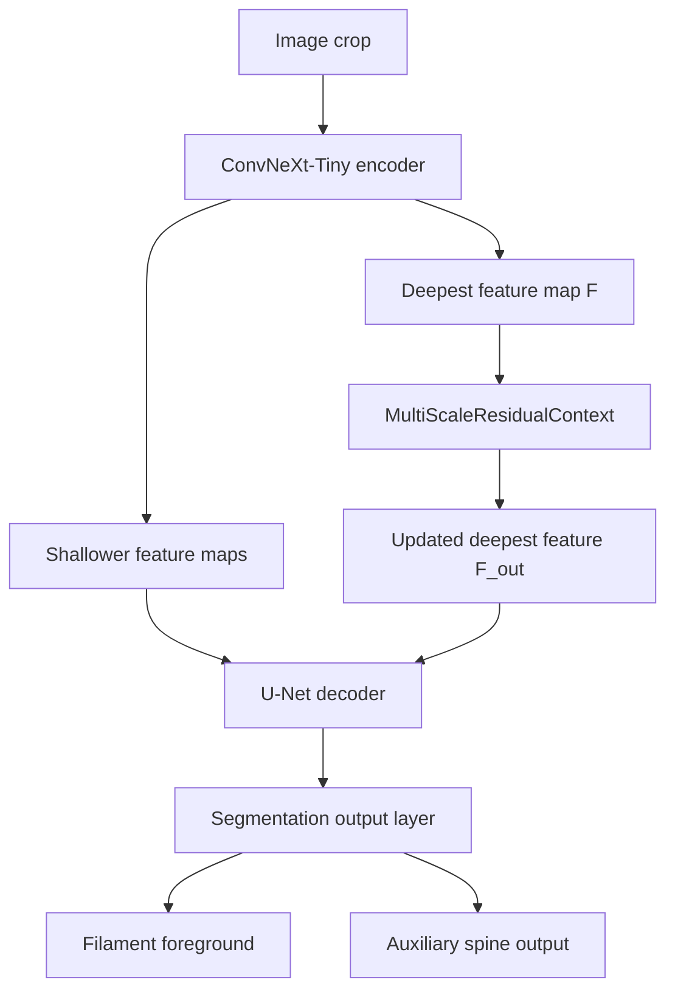

# Native U-Net and the context-block experiment

The production baseline combines YOLO26s-seg and the original native `best84` predictions. The current SWEFil experiment trains only a fresh native network. Both native networks use **ConvNeXt-Tiny as the encoder and U-Net as the decoder**. The context variant is implemented and was evaluated historically; it is not enabled in either of those current entry points.

## From image to instances

1. Correct the input's limb-darkening pattern and normalize image crops. Full-resolution tiled inference preserves the original 2048 × 2048 output coordinates.
2. The **encoder** extracts feature maps at several spatial resolutions. Deeper features summarize broader structures; shallower features retain more spatial detail.
3. The **decoder** upsamples and combines those features through skip connections to recover a pixel-level prediction.
4. The foreground output becomes a probability map. Tile blending, thresholding and connected components produce candidate instance masks. The frozen ensemble additionally combines these with independent YOLO predictions and applies its established candidate/boundary rules.
5. Final masks are assigned non-overlapping pixels and encoded as compressed COCO RLE for submission.

The full submission recipe is described in [Current pipeline](CURRENT_PIPELINE.md). The SWEFil native-only validation uses its own declared threshold/area grid; its PQ must not be reported as the full ensemble score.

## Exact context-block insertion



**This diagram shows the context-enabled experiment.** In the current baseline and SWEFil trainer, `F` goes directly to the decoder and the context block is absent.

The implementation in [`PaperUNet.forward`](../tools/paper_multiscale.py) performs:

```python
features = list(self.base.encoder(image))
features[-1] = self.context(features[-1])
decoded = self.base.decoder(features)
return self.base.segmentation_head(decoded)
```

Only the deepest feature is modified. The decoder's skip inputs, original crop coordinates and output dimensions are preserved. The context block is inside the neural network, before pixel predictions; it is not image preprocessing or a mask postprocessing rule.

## What the block calculates

For a deepest feature map `F` of shape `[batch, channels, height, width]`:

| Step | Operation | Purpose |
|---|---|---|
| Reduce channels | 1 × 1 convolution → GroupNorm → SiLU | Work with at most 128 channels |
| Three parallel branches | Depthwise 3 × 3 convolutions at dilation rates **1, 3, 5**, each followed by GroupNorm and SiLU | Examine several spatial scales |
| Crop summary branch | Global average pooling → 1 × 1 convolution → GroupNorm → SiLU, then broadcast to the feature-map size | Add a summary of the current crop |
| Fuse | Concatenate all four branches; 1 × 1 convolution back to the original channel count | Learn a combined context residual `R(F)` |
| Add residual | `F_out = F + tanh(g) × R(F)` | Learn how much the context changes the original feature |

“Global” pooling covers **the current crop**, not the whole solar disk when inference is tiled. The dilated kernels span 3, 7 and 11 positions on the deepest feature grid, respectively; those numbers are not original-image pixel sizes.

The scalar gate `g` starts at zero. Therefore, with the same base weights, the new block initially returns the original features. The gate can learn on the first update; as it moves away from zero, gradients also train the context branches. GroupNorm supports the small T4 batches, including the pooled 1 × 1 branch.

The design is motivated by the need to distinguish faint, elongated structures from nearby texture while retaining local detail through the skip connections. The particular rates and placement are experiment choices, not values derived from the dataset or proven optimal. This module is a convolutional residual extension; it does not perform LoRA or Transformer attention.

## Training behavior and the spine output

The original native model has two independent output channels:

- **Foreground:** the filament-region prediction used for masks and PQ evaluation.
- **Spine:** an auxiliary centerline prediction intended to help learn filament structure. It is not required by the submission format and is not used by final foreground inference.

The current training loss is foreground BCE plus Dice, with `0.1 × spine loss` where genuine GONG spine labels are available. SWEFil and CHASE synthesis have no genuine spine targets, so they contribute no spine supervision. An isolated improvement from the spine objective has not been established by an ablation here.

The historical context experiment loads the original best84 base weights, inserts the zero-gated block, and fine-tunes the network with a fresh optimizer. The original encoder and decoder are trainable too: the zero gate is not a freeze mechanism. This differs from the current SWEFil run, which starts from an ImageNet encoder and new decoder, uses no context block, and follows the new data mixture.

For code-level construction, the existing wrapper accepts an SMP U-Net:

```python
from paper_multiscale import PaperUNet

context_model = PaperUNet(native_model, method="multiscale_context")
```

This illustrates the wrapper interface; it is not a setting that enables the block in the current Colab notebook. A trained context model must save and reload the **entire wrapper state**, including the base network, context branches and gate. Historical `paper_context_only.py` is a pinned reproduction driver that also requires its original runtime and experiment assets.

## What the historical comparison showed

The [context experiment record](CONTEXT_ROUND9_RESULTS.ko.md) reports:

| Comparison | Original | Context variant | Interpretation |
|---|---:|---:|---|
| Native-only fixed-validation PQ | 0.429419 | 0.433211 at selected epoch 45 | Small development gain; TP fell by 4 and FP fell by 9 |
| Full ensemble with complete native-model replacement | 0.472593 | 0.471913 | Did not improve the existing combination |
| Best limited integration among the recorded settings | 0.472593 | 0.472955 | Very small development gain; insufficient evidence to adopt |

The original native score in that comparison was a logged same-T4 result; the context best45 CSV was independently rescored. The design also changed cumulative training, so these numbers do not isolate the architectural contribution. Repeated use of the same validation set further limits claims of generalization. No public-LB improvement was established for this block, and the submitted baseline remained unchanged.

## Source map

- [`solar_a100_train_standalone.py`](../tools/solar_a100_train_standalone.py): base model, loss and foreground inference.
- [`paper_multiscale.py`](../tools/paper_multiscale.py): context block, wrapper and original-weight loading.
- [`paper_context_only.py`](../tools/paper_context_only.py): historical context fine-tuning with a fixed best84 reference.
- [`swefil_mixed_training.py`](../tools/swefil_mixed_training.py): current GONG/SWEFil/CHASE native training, without the context block.
- [`test_paper_multiscale.py`](../tests/test_paper_multiscale.py): existing tests for shapes, zero-gate equivalence, gradients and complete checkpoint loading.
